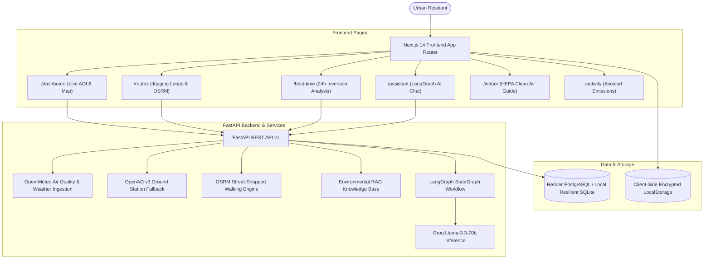

# BreatheWise AI — Pollution-Aware Fitness & Mobility Assistant

> **A production-ready environmental health and urban mobility web application designed for city dwellers navigating air pollution.** BreatheWise AI empowers urban residents to plan outdoor fitness, minimize inhaled particulate dosage, find tree-canopied jogging routes, and make scientifically grounded health decisions.

## 🎯 1. Chosen Vertical

**Vertical:** **Urban Environmental Health, Preventive Wellness & Sustainable Mobility**

Rapid urbanization and atmospheric stagnation create hazardous air quality across major metropolitan areas worldwide. Traditional weather apps provide generic city-wide AQI numbers without actionable fitness guidance. 

BreatheWise AI bridges the gap between **environmental meteorology**, **human respiratory physiology**, and **urban mobility**. Rather than telling users to stay home indefinitely, it provides **exposure-minimized route alternatives**, **optimal exercise windows based on thermal inversion cycles**, and **exact inhaled particulate dose calculations**.

---

## 🧠 2. Approach & Scientific Logic

BreatheWise AI is engineered around deterministic scientific formulas, meteorological physics, and agentic AI orchestration:

### A. Deterministic Human Inhaled Dose Estimation
We calculate the cumulative inhaled particulate mass ($\mu\text{g}$ of $PM_{2.5}$) using physiological minute ventilation formulas:

$$\text{Ventilation Rate } (V_E) = V_0 \times \text{MET}$$
$$\text{Inhaled Dose } (\mu\text{g}) = V_E \times \text{Duration (min)} \times \text{Effective } PM_{2.5} \times 10^{-3}$$

- **$V_0$ (Baseline Ventilation):** $\approx 0.006 \text{ m}^3/\text{min}$ for healthy adults.
- **$\text{MET}$ (Metabolic Equivalent of Task):** 
  - Rest/Yoga: $1.5 - 2.5\text{ MET}$
  - Brisk Walking: $3.5 - 4.5\text{ MET}$
  - Outdoor Jogging: $7.0 - 9.0\text{ MET}$
  - Fast Cycling: $8.0 - 10.0\text{ MET}$
- **Effective Concentration:** Ambient $PM_{2.5}$ modified by proximity to arterial roadways (e.g., $1.25\times$ near highways vs $0.82\times$ along residential parkways).

### B. Atmospheric Boundary Layer & Thermal Inversion Modeling
Urban air pollution follows a diurnal curve dictated by solar radiation and planetary boundary layer (PBL) dynamics:
- **Night & Early Morning (Thermal Inversion):** Radiation cooling traps vehicle tailpipe emissions near ground level ($06:00 - 08:30$). High risk of acute respiratory distress.
- **Midday to Afternoon (Convective Dilution):** Solar heating drives turbulent thermal mixing, expanding the mixing height ($1000 - 2000\text{ m}$) and significantly diluting ground particulates ($11:00 - 16:30$).
- BreatheWise AI computes hourly recommendation scores ($0 - 100$) by pairing boundary layer convective forecast indices with real-time temperature, wind dispersion, and hourly $PM_{2.5}$ trends.

### C. Road-Snapped Goal-Based Jogging Circuit Engine
Instead of drawing geometric polygons across city blocks, BreatheWise AI computes realistic jogging circuits:
1. Calculates target circle radius from daily distance: $R = \frac{\text{Distance}}{2 \pi \times 1.35}$ (accounting for urban street winding factor).
2. Computes directional cardinal waypoints around parks and quiet residential avenues.
3. Queries the **OSRM** walking routing engine (`/route/v1/walking/...`) to generate 150–250+ turn-by-turn road vertices tracing real sidewalks and pedestrian paths back to the origin.

### D. Grounded LangGraph Agentic Architecture
The conversational assistant (`/assistant`) uses a compiled **LangGraph `StateGraph`**:
- **`retrieve_rag` Node:** Semantic vector search against verified documentation from WHO 2021, CPCB NAQI, US EPA, and NIOSH.
- **`execute_tools` Node:** Dispatches real-time tools based on user intent (`tool_get_current_aqi`, `tool_get_exercise_windows`, `tool_estimate_exposure`).
- **`synthesize_response` Node:** Injects active user location context and tool outputs into **Groq LLM (`llama-3.3-70b-versatile`)** with strict factual guardrails and structured citation cards.

---

## ⚙️ 3. How the Solution Works



### End-to-End User Flow:
1. **Onboarding & Location Selection:** The user defines their home city, vulnerability factors (asthma, age group), and daily workout targets. Coordinates are resolved via high-precision local registries and geocoding fallbacks.
2. **Dashboard Atmospheric Monitoring:** Real-time $PM_{2.5}$, $PM_{10}$, temperature, wind speed, and an interactive MapLibre GL station map give immediate environmental awareness.
3. **Route Planning:** User types an exact distance goal (e.g. `4.5 km`) and a starting neighborhood (e.g. `Anna Nagar`). The engine recommends 3 distinct circuits: **Lowest Exposure** (residential streets), **Greenest** (parks & botanical buffers), and **Fastest** (paved avenues).
4. **Interactive AI Guidance:** The user asks questions in natural language. The assistant automatically incorporates their active city, queries live local monitors, and synthesizes answers with WHO/CPCB source citations.

---

## 📌 4. Assumptions Made

1. **Station Proximity & Grid Resolution:** Open-Meteo planetary model operates on an 11 km atmospheric grid. While verified ground stations (OpenAQ) are prioritized, microclimatic street canyon effects can vary based on heavy vehicular idling.
2. **Pedestrian Speed & Route Factor:** Walking speed is modeled at $4.8\text{ km/h}$, recreational jogging at $9.0\text{ km/h}$, and cycling at $15.0\text{ km/h}$. The urban street winding factor is estimated at $1.35$ for circle perimeter loops.
3. **Vegetative Filtration Factor:** Green buffer exposure reductions ($14\% - 18\%$ reduction in effective $PM_{2.5}$) assume mature canopy cover and foliage density based on published urban forestry studies.
4. **Avoided Emissions Baseline:** The low-emission mobility calculator assumes displaced travel replaces an average passenger petrol vehicle producing $170\text{ g } CO_2e/\text{km}$, $0.003\text{ g } PM_{2.5}/\text{km}$, and $0.18\text{ g } NO_x/\text{km}$ (UK DEFRA 2023 factors).
5. **Medical Non-Diagnosis:** The application explicitly assumes and states that guidance does not constitute direct medical diagnosis or clinical treatment.

---

## 🛠️ Technology Stack

| Layer | Technologies |
|---|---|
| **Frontend** | Next.js 14 (App Router), React, TypeScript, Tailwind CSS, Lucide Icons, MapLibre GL JS |
| **Backend** | Python 3.11, FastAPI, Pydantic v2, SQLAlchemy, Uvicorn, Cachetools |
| **AI & Orchestration** | LangGraph (`StateGraph`), Groq API (`llama-3.3-70b-versatile`), Environmental RAG |
| **Geospatial & Routing** | OpenStreetMap (OSM), Open Source Routing Machine (OSRM demo API), Photon Geocoder |
| **Environmental Ingestion** | Open-Meteo Air Quality & Weather API (open access), OpenAQ v3 API |
| **Database** | Render PostgreSQL (with automatic local SQLite resilient fallback) |
| **Deployment** | Docker, Docker Compose, Render (Backend Web Service), Vercel (Frontend Next.js) |

---

## 🚀 Quick Start Guide

### 1. Clone & Set Up Backend
```powershell
cd backend
python -m venv .venv
.\.venv\Scripts\activate
pip install -r requirements.txt
uvicorn app.main:app --reload --port 8000
```
- API Health Check: `http://localhost:8000/health`
- Interactive Swagger Docs: `http://localhost:8000/docs`

### 2. Set Up Frontend
```powershell
cd frontend
npm install
npm run dev
```
- Open `http://localhost:3000` in your browser.

---

## 🔒 Security & Privacy Architecture

- **Zero Credentials in Code:** All keys and database URLs are loaded strictly through `.env` files via Pydantic `BaseSettings`.
- **CORS Defense:** Backend enforces `allow_origin_regex` to restrict access strictly to trusted domains and Vercel production deployments.
- **Data Sovereignty:** Full GDPR-compliant data export (`/profile`) allows users to download their activity records as JSON or permanently wipe local tracking.
